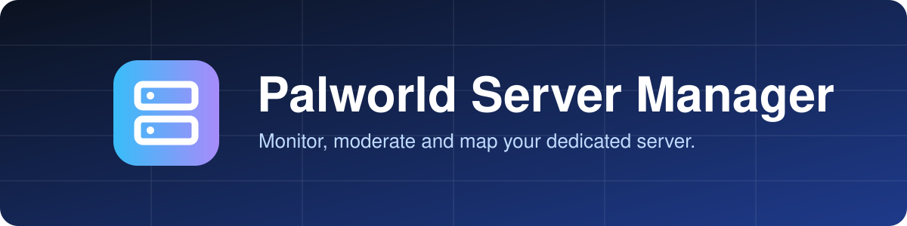
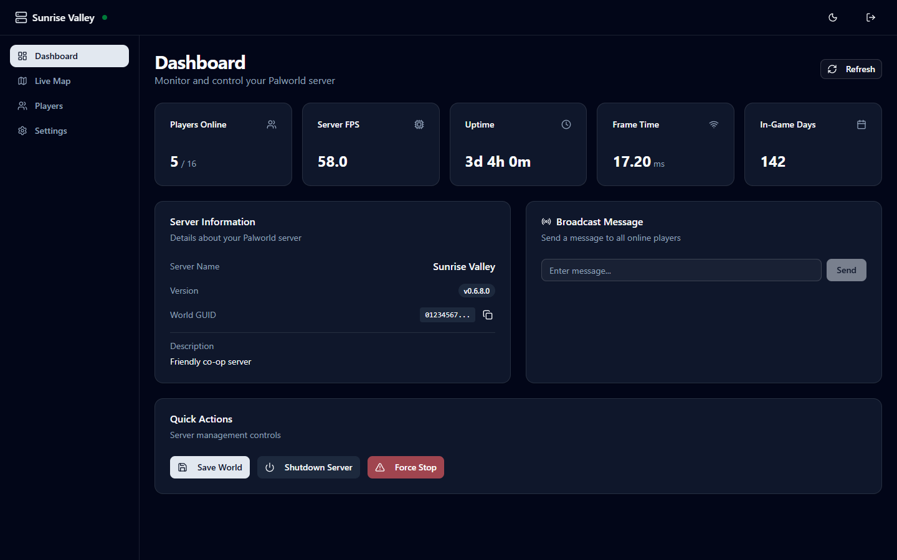
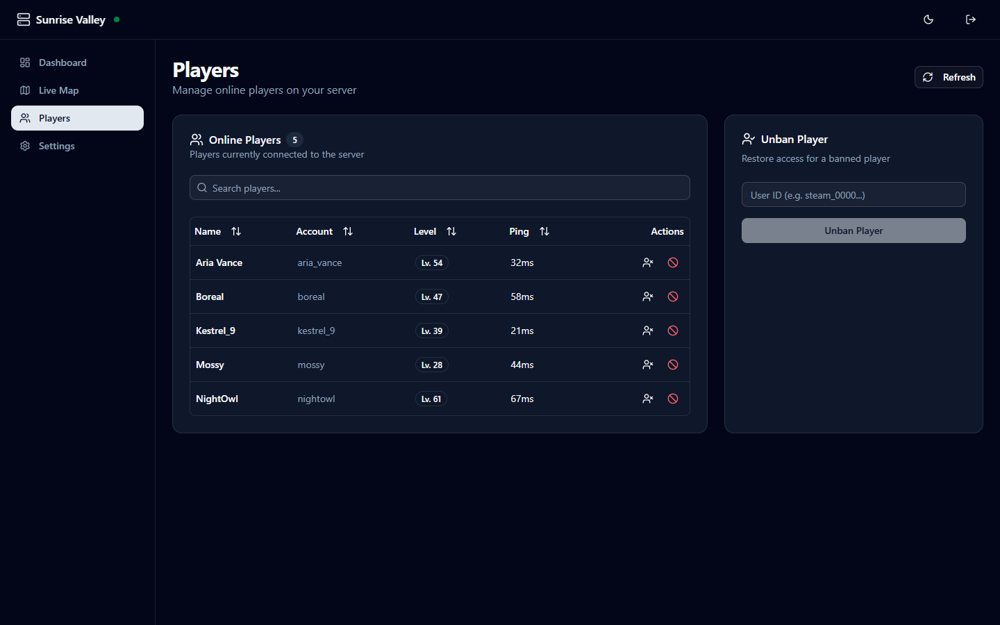
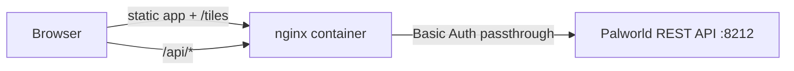

<div align="center">



**A fast, self-hosted web dashboard for Palworld dedicated servers.**
Live stats, player moderation and a live map, on top of the official REST API.

[](https://github.com/yar1k0v/palworld-dashboard/actions/workflows/ci.yml)
[](https://github.com/yar1k0v/palworld-dashboard/actions/workflows/docker-publish.yml)
[](LICENSE)


[Quick start](#quick-start) · [Live map](#live-map) · [Development](#development) · [Security](#security)

</div>

<p align="center">
  
  
</p>

<sub>Screenshots use a mock server with invented players.</sub>

## What you get

| | |
|---|---|
| **Dashboard** | Server FPS, uptime, player count and in-game days, refreshed every 10 s |
| **Players** | Who is online, with ping and level. Kick, ban and unban in one click |
| **Live map** | Player positions and fast travel towers on Palpagos and the World Tree |
| **Server control** | Broadcast a message, save the world, shut down gracefully or force stop |
| **Settings** | Browse the full server configuration, read-only |
| **Comfortable UI** | Dark and light theme, works on a phone |

## Quick start

**1. Turn on the API** in `PalWorldSettings.ini` on the game server:

```ini
RESTAPIEnabled=True
RESTAPIPort=8212
AdminPassword=<your password>
```

**2. Run the dashboard:**

```bash
docker run -d --name palworld-manager -p 3000:80 \
  -e API_BACKEND_URL=http://your-palworld-server:8212 \
  ghcr.io/yar1k0v/palworld-dashboard:latest
```

**3. Open** `http://localhost:3000` and sign in with your admin password. The user name is always `admin`.

Prefer Compose? See [`docker-compose.yml`](docker-compose.yml).

| Variable | Default | Meaning |
|---|---|---|
| `API_BACKEND_URL` | `http://localhost:8212` | Palworld REST API base URL, no trailing slash |

## How it fits together



The browser never talks to the game server directly. nginx serves the app and forwards `/api/*` to `API_BACKEND_URL`.

## Live map

The map needs tiles. This repo does not ship them because the artwork belongs to Pocketpair. Build them once from **your own** Palworld install (Windows, Steam):

```bash
pip install Pillow
python tools/make_tiles.py
```

<details>
<summary>Options, Docker and troubleshooting</summary>

- Output: `public/tiles` and `public/tiles-tree` (git-ignored)
- Palworld is not in `C:\Games\Steam`? Pass `--pak "<path>\Pal-Windows.pak"`
- Script finds no Oodle library? Pass `--oodle <path>` to an `oo2core_*_win64.dll`. Any installed game that ships one works.
- Without tiles, the Map page shows a notice and still plots players on a blank map

Mount the tiles read-only into the container:

```bash
docker run ... \
  -v ./public/tiles:/usr/share/nginx/html/tiles:ro \
  -v ./public/tiles-tree:/usr/share/nginx/html/tiles-tree:ro ...
```

</details>

## Development

Needs Node.js 20+ and pnpm 10.

```bash
pnpm install
pnpm dev        # http://localhost:5173, proxies /api/* to localhost:8212
pnpm lint
pnpm build
```

Server is remote? Tunnel the API port first:

```bash
ssh -L 8212:localhost:8212 user@your-server -N
```

Built with React 19, TypeScript, Vite, Zustand, SWR, Tailwind CSS 4, shadcn/ui and Leaflet. Contributions are welcome, see [CONTRIBUTING.md](CONTRIBUTING.md).

## Security

- ⚠ The dashboard gives full admin control. Anyone who reaches it and knows the password controls your server.
- ⚠ The Palworld REST API is not built for the open internet. Keep it on a LAN or behind a VPN.
- Put HTTPS in front of the dashboard. Basic Auth sends the password on every request.
- The browser keeps the password in `sessionStorage` until the tab closes.

Found a vulnerability? See [SECURITY.md](SECURITY.md).

## Compatibility

Field names follow the Palworld REST API docs v1.0.4 (game patch 1.0.5 is current). Dashboard, players and map checked on a live server. Kick, ban and unban checked against a mock server only. Open an issue if a field differs.

## Disclaimer

Unofficial fan project. Not affiliated with or endorsed by Pocketpair, Inc. Palworld and its artwork belong to Pocketpair, Inc.

## License

[MIT](LICENSE). The license covers this code, not game assets.
